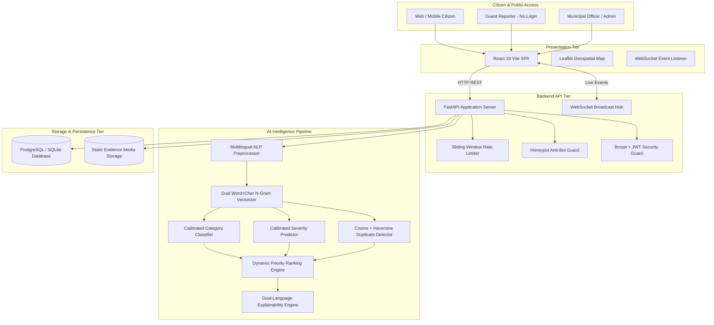

# CivicAI Bangladesh - Technical Architecture Specification

## 1. Executive Summary

CivicAI Bangladesh is built as a modular, decoupled full-stack architecture designed for high availability, low latency, and scalable public civic governance.

The system comprises three primary tiers:
1. **Frontend Presentation Tier:** React 19 Single Page Application (SPA) styled strictly with a single primary color palette (Bangladesh Civic Emerald `#059669` / `#047857`) and neutral slates, featuring responsive mobile-first views and interactive Leaflet OpenStreetMap layers.
2. **Backend Application & Real-Time Gateway:** Python FastAPI asynchronous REST API handling authentication, guest rate limiting, validation, geospatial querying, and WebSockets broadcasting.
3. **AI Intelligence Engine:** Standalone, reproducible NLP & ML pipeline integrating multilingual normalization (Bangla, English, Banglish), sublinear TF-IDF word+char feature extraction, calibrated classifiers, semantic cosine similarity, Haversine geospatial proximity clustering, and factor-based explainability.

---

## 2. Component Architecture Diagram



---

## 3. Database Schema Design (Entity-Relationship)

The persistence layer is managed via SQLAlchemy 2.0 with standard relational integrity:

1. **`users` Table:**
   - `id` (PK, Int)
   - `email` (Unique, String)
   - `phone` (String, Nullable)
   - `full_name` (String)
   - `hashed_password` (Bcrypt 72-byte limit compliant)
   - `role` ('citizen', 'officer', 'admin')
   - `department` (String, Nullable)
   - `is_active` (Boolean)
   - `created_at` (Timestamp)

2. **`complaints` Table:**
   - `id` (PK, Int)
   - `tracking_id` (Unique, String, Indexed e.g., `BD-2026-X8F4K2`)
   - `access_pin` (Hashed PIN for guest tracking)
   - `title`, `description` (Text)
   - `is_guest` (Boolean)
   - `citizen_id` (FK -> users.id, Nullable)
   - `contact_email`, `contact_phone` (Masked in public responses)
   - `is_anonymous` (Boolean)
   - `division`, `district`, `upazila`, `area_name` (Indexed strings)
   - `latitude`, `longitude` (Float, Indexed)
   - `category`, `severity` (Strings)
   - `status` (`Submitted`, `AI_Analyzed`, `Verified`, `Assigned`, `In_Progress`, `Resolved`, `Rejected`, `Duplicate_Merged`)
   - `assigned_department`, `assigned_officer`, `sla_deadline`
   - `ai_category`, `ai_category_confidence`, `ai_severity`, `ai_severity_confidence`
   - `ai_priority_score`, `ai_priority_level`, `ai_urgency_score`, `ai_urgency_keywords`
   - `ai_explanation_en`, `ai_explanation_bn`, `ai_raw_json`
   - `admin_override`, `admin_override_reason`
   - `upvotes_count`, `comments_count`
   - `image_urls`, `resolution_notes`, `resolution_image_urls`, `resolved_at`

3. **`complaint_timeline` Table:**
   - `id` (PK)
   - `complaint_id` (FK -> complaints.id)
   - `status`, `title`, `description`, `performed_by`, `created_at`

4. **`complaint_comments` Table:**
   - `id` (PK)
   - `complaint_id` (FK -> complaints.id)
   - `author_name`, `comment_text`, `is_official_response`, `created_at`

5. **`complaint_upvotes` Table:**
   - `id` (PK)
   - `complaint_id` (FK -> complaints.id)
   - `ip_hash` (Indexed, SHA-256 for anonymous deduplication)

6. **`duplicate_clusters` Table:**
   - `id` (PK)
   - `primary_complaint_id` (FK -> complaints.id)
   - `duplicate_complaint_id` (FK -> complaints.id)
   - `similarity_score`, `distance_km`, `merged_at`

7. **`audit_logs` Table:**
   - `id` (PK)
   - `action`, `entity_type`, `entity_id`, `performed_by_id`, `performed_by_email`, `details`, `created_at`

---

## 4. Real-Time WebSocket Protocol

- Endpoint: `/ws/complaints`
- Heartbeat: Client sends `"ping"`, server replies `"pong"`.
- Event Structure:
```json
{
  "event": "NEW_COMPLAINT" | "STATUS_CHANGED" | "NEW_COMMENT" | "UPVOTE_UPDATED",
  "data": { ... }
}
```
When an administrative action or new citizen complaint occurs, the event is instantaneously broadcast to all connected web clients without polling.
